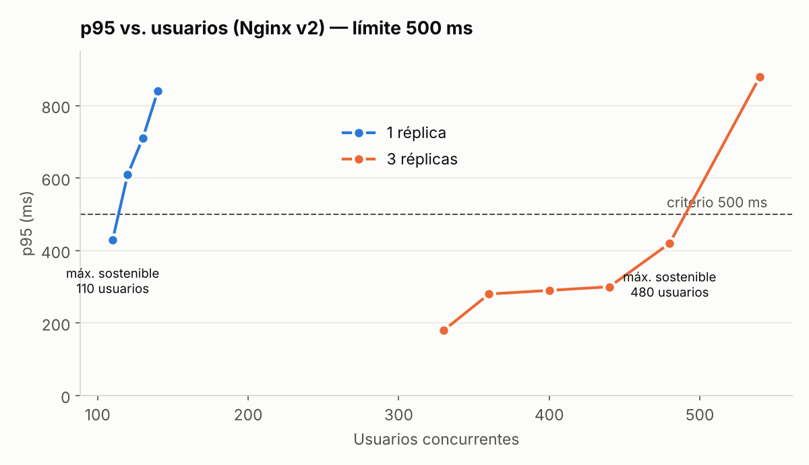
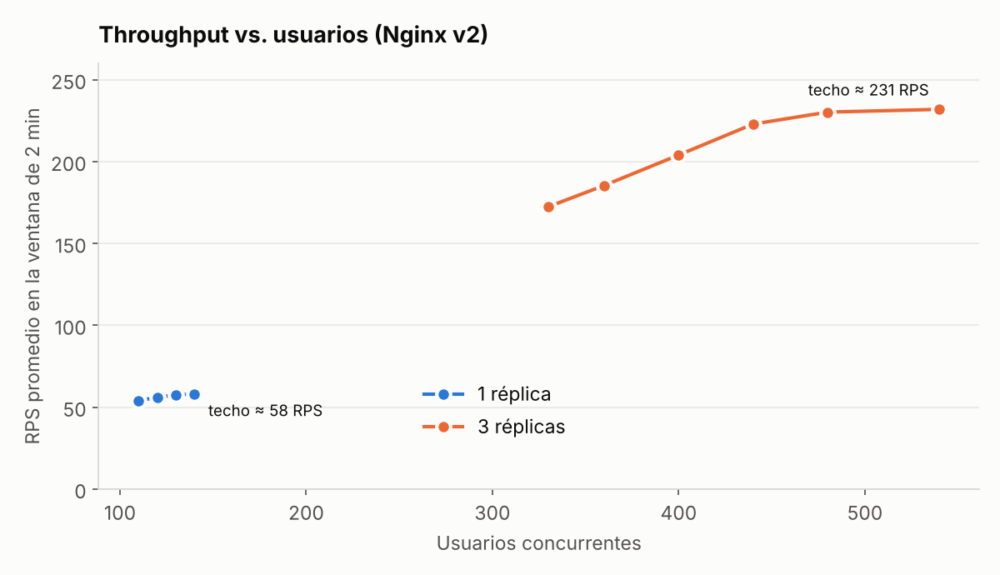
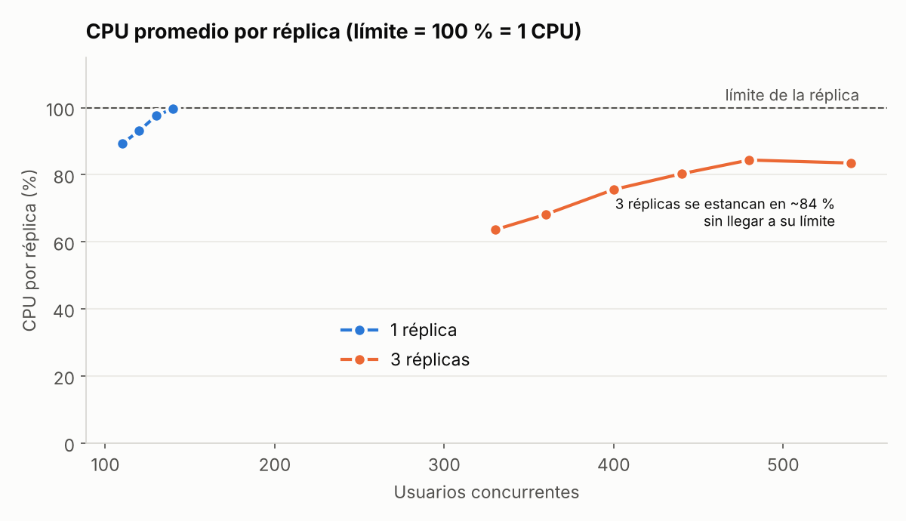

# Taller Locust — Capacidad de una API de inferencia con MLflow (1 vs. 3 réplicas)


Este repositorio parte del **taller de MLflow** (PostgreSQL para metadata, MinIO para artefactos, JupyterLab para experimentar y una API FastAPI que toma el modelo `penguins-classifier@produccion` del Model Registry). Sobre esa base se publica la imagen de inferencia en Docker Hub, se despliega detrás de Nginx con réplicas limitadas a **1 CPU / 1 GB** y se mide su capacidad con **Locust** desde otra máquina.

## Arquitectura

```text
PC Windows (generador)                     VM Javeriana 10.43.97.102 (4 vCPU, 15 GiB)
┌────────────────────────┐   VPN    ┌──────────────────────────────────────────────────┐
│ Docker Desktop         │ ───────▶ │ tm_nginx :8000 ─▶ api-1 (1 CPU / 1 GB)           │
│ locustio/locust:2.46.7 │          │                ─▶ api-2 (1 CPU / 1 GB)  (×3)     │
│ (12 CPU asignadas)     │          │                ─▶ api-3 (1 CPU / 1 GB)  (×3)     │
└────────────────────────┘          │ tm_mlflow ─▶ tm_postgres_mlflow (metadata)       │
                                    │           ─▶ tm_minio (artefactos del modelo)    │
                                    │ tm_jupyter + tm_postgres_data → solo para entrenar│
                                    └──────────────────────────────────────────────────┘
```

- Imagen publicada: **`annamerchanlm/penguins-api-mlflow:v1`** (digest `sha256:d8c7f0cb5558…`, 290 MB comprimida).
- La API carga el modelo **una vez** desde MLflow/MinIO; después predice desde memoria.

## Cambios frente al taller de MLflow

| Cambio | Archivo | Motivo |
|---|---|---|
| `build: ./api` → `image: annamerchanlm/penguins-api-mlflow:v1` | `docker-compose.yaml` | Desplegar la imagen publicada (puntos 2 y 3) |
| Sin `container_name` ni `ports` en `api`; `expose: 8000` | `docker-compose.yaml` | Permitir `--scale api=3` |
| `cpus: "${API_CPUS:-1.0}"`, `mem_limit: "${API_MEMORY:-1g}"` | `docker-compose.yaml` | Límite de 1 CPU / 1 GB **por réplica** |
| Healthcheck que exige `modelo_cargado == true` | `docker-compose.yaml` | `/health` original responde 200 aunque no haya modelo; además fuerza la carga antes de recibir tráfico |
| Servicio `nginx` (único puerto abierto: 8000) | `docker-compose.yaml`, `nginx/nginx.conf` | Balanceador entre réplicas |
| `profiles: ["train"]` en `jupyter` y `postgres_data` | `docker-compose.yaml` | No compiten por CPU/RAM durante las pruebas |
| MLflow, MinIO y Jupyter publicados solo en `127.0.0.1` | `docker-compose.yaml` | No exponerlos a la red de la universidad |

## Cómo reproducir

```bash
# VM
git clone <este-repo> ~/taller-locust && cd ~/taller-locust
cp .env.example .env            # llenar credenciales
docker compose --profile train up -d --build      # entrenar: correr notebooks 01 y 02 en Jupyter
docker compose stop jupyter postgres_data
docker compose up -d --scale api=1                # o api=3
./monitor_stats.sh <nombre>                       # registra docker stats con marca de tiempo
```

```powershell
# Máquina generadora (PowerShell), un nivel:
docker run --rm -v ${PWD}:/mnt/locust locustio/locust:2.46.7 -f /mnt/locust/locustfile.py `
  --headless --host http://10.43.97.102:8000 -u 110 -r 10 -t 131s --reset-stats `
  --csv /mnt/locust/resultados/rep1v2_u110 --html /mnt/locust/resultados/rep1v2_u110.html
```

## Método

| Parámetro (igual para 1 y 3 réplicas) | Valor |
|---|---|
| `locustfile.py` | `wait_time = between(1, 2.5)`; 3 pingüinos reales al azar; falla si no hay `especie_predicha` |
| Spawn rate | 10 usuarios/s |
| Ventana medida | 2 min **después** de crear todos los usuarios (`--reset-stats`; run time = usuarios/10 + 120 s) |
| **Criterio "soporta"** | **< 1 % de fallos y p95 < 500 ms** en la ventana |
| Generador | PC Windows por VPN; Locust 2.46.7 en Docker Desktop (12 CPU) |

RPS = `Requests/s` del `*_stats.csv` de Locust. CPU/RAM = promedio de `docker stats` en la misma ventana.

## Resultados oficiales (Nginx v2, misma configuración para 1 y 3 réplicas)

### 1 réplica (1 CPU / 1 GB)

| Usuarios | RPS | Peticiones | Fallos | p50 | **p95** | p99 | CPU réplica | RAM réplica | Cumple |
|---:|---:|---:|---:|---:|---:|---:|---:|---:|:---:|
| **110** | **54,1** | 6.847 | 0 % | 150 ms | **430 ms** | 550 ms | 89 % | 181 MiB | ✅ |
| 120 | 55,9 | 7.087 | 0 % | 250 ms | 610 ms | 1.000 ms | 93 % | 181 MiB | ❌ |
| 130 | 57,5 | 7.276 | 0 % | 390 ms | 710 ms | 910 ms | 98 % | 181 MiB | ❌ |
| 140 | 58,1 | 7.310 | 0 % | 530 ms | 840 ms | 1.000 ms | 100 % | 182 MiB | ❌ |

### 3 réplicas (1 CPU / 1 GB cada una)

| Usuarios | RPS | Peticiones | Fallos | p50 | **p95** | p99 | CPU por réplica | CPU total API | RAM por réplica | Cumple |
|---:|---:|---:|---:|---:|---:|---:|---:|---:|---:|:---:|
| 330 | 172,4 | 21.361 | 0 % | 62 ms | 180 ms | 310 ms | 64 % | 191 % | 172 MiB | ✅ |
| 360 | 185,4 | 23.504 | 0 % | 68 ms | 280 ms | 410 ms | 68 % | 205 % | 172 MiB | ✅ |
| 400 | 204,0 | 25.829 | 0 % | 87 ms | 290 ms | 400 ms | 76 % | 227 % | 173 MiB | ✅ |
| 440 | 222,9 | 28.318 | 0 % | 100 ms | 300 ms | 460 ms | 80 % | 241 % | 173 MiB | ✅ |
| **480** | **230,2** | 29.626 | 0 % | 200 ms | **420 ms** | 560 ms | 84 % | 253 % | 173 MiB | ✅ |
| 540 | 231,9 | 29.511 | 0 % | 350 ms | 880 ms | 4.300 ms | 84 % | 251 % | 174 MiB | ❌ |





Tabla completa (incluye CPU de Nginx, MLflow, MinIO y Postgres por corrida): [`resultados/tabla_resultados.csv`](resultados/tabla_resultados.csv). Reportes HTML de Locust: `resultados/*.html`.

## Respuestas

**1. Concurrencia máxima sostenible y RPS con 1 réplica (1 CPU / 1 GB).**
**110 usuarios, 54,1 RPS** (p95 430 ms, 0 fallos). Con 120 usuarios el RPS casi no sube (55,9) y el p95 pasa a 610 ms. El techo de la réplica es **≈ 58 RPS**, con la CPU al 100 %.

**2. Concurrencia máxima sostenible y RPS con 3 réplicas.**
**480 usuarios, 230,2 RPS** (p95 420 ms, 0 fallos). Con 540 usuarios se procesan las mismas peticiones (29.511 vs. 29.626) y el p95 sube a 880 ms: el techo es **≈ 231 RPS**.

**3. ¿En qué porcentaje cambió la capacidad? ¿Fue cercano a 3×?**

| | 1 réplica | 3 réplicas | Cambio |
|---|---:|---:|---:|
| Usuarios sostenibles | 110 | 480 | **+336 % (×4,4)** |
| RPS en el límite | 54,1 | 230,2 | **+325 % (×4,3)** |
| Techo de RPS | 58,1 | 231,9 | +299 % (×4,0) |

El aumento **superó 3×**. Hay dos efectos medidos:
- **Cola compartida.** Con 3 servidores y una sola fila (Nginx reparte a la réplica libre), la latencia aguanta mucho mejor cerca del límite que con 1 servidor. Por eso, con el mismo p95, se sostienen proporcionalmente más usuarios.
- **Menos CPU por petición.** `CPU total de la API ÷ RPS` da **15,5–17,2 ms por petición con 1 réplica** y **10,8–11,1 ms con 3 réplicas**, incluso a carga baja (1 réplica con 26,5 RPS: 15,7 ms; 3 réplicas con 26,5 RPS cada una: 12,9 ms). No logramos aislar la causa con los datos disponibles; la hipótesis es el costo de concentrar todas las conexiones keep-alive de Nginx y toda la cola en un solo proceso uvicorn (un solo hilo de ejecución por el GIL). Queda como trabajo futuro medir con `perf`/`py-spy` dentro de la réplica.

A la vez aparece **otro cuello de botella**: con 3 réplicas, ninguna llegó a su límite (se estancaron en **~84 %** con 480 y 540 usuarios), así que el techo de 231 RPS **no lo puso la CPU de las réplicas**.

**4. ¿Qué recurso se saturó primero y qué evidencia hay?**
- **1 réplica: la CPU de la réplica.** `docker stats` la muestra en **99,7 %** con 140 usuarios mientras el RPS se aplana en 58. La RAM nunca fue el límite: **181 MiB de 1 GiB (18 %)**.
- **3 réplicas: un recurso compartido de la VM.** Las réplicas se quedaron en ~84 % y la suma de todos los contenedores fue ~258 % de los 400 % (4 vCPU) de la VM. `docker stats` no muestra el CPU del host (red del kernel/NAT de Docker, `dockerd`, el propio monitoreo con `docker stats`), y esa es la explicación más probable de la diferencia; confirmarlo requiere `mpstat`/`top` en la VM durante la prueba. RAM por réplica: 173 MiB (17 %).
- **Locust (generador):** sin ninguna advertencia `CPU usage above 90%` en ninguna corrida, incluida la de 540 usuarios (~232 RPS). El límite medido es del servicio, no del generador.
- **Red/VPN:** con 1 solo usuario la mediana fue 110 ms; es el piso de latencia que pone la VPN, que deja ~390 ms de margen al criterio.

**5. ¿Qué servicios adicionales pudieron limitar el resultado?**
- **Nginx (balanceador) — sí limitó, y es el hallazgo principal.** Con su configuración por defecto (`max_fails=1`, `fail_timeout=10s`), cada reset de una conexión keep-alive (`recv() failed (104)`) sacaba una réplica del grupo durante 10 s. Con 3 réplicas eso produjo `no live upstreams`: **73 errores 502 en ráfaga** y p95 de 570 ms con 330 usuarios. Con 1 réplica no pasa porque Nginx ignora `max_fails` cuando hay un solo servidor. Tras ajustar `max_fails=3 fail_timeout=5s` y `keepalive_timeout 4s` (menor que los 5 s de uvicorn), el mismo nivel dio **0 fallos y p95 de 180 ms**, y el límite de 3 réplicas pasó de **300 a 480 usuarios**. Antes de las corridas oficiales también se subió `worker_connections` (512 por defecto) a 4096: en la exploración aparecieron conexiones cortadas (`HTTP 0`) por encima de ~250 usuarios, consistente con ese límite, aunque no se confirmó en los logs.
- **MLflow, MinIO y PostgreSQL — no limitaron el throughput.** Durante la carga: MLflow **0,0 % de CPU**, MinIO ≤ 1,1 %, Postgres ≤ 1,7 %. No están en el camino de cada petición: la API los usa solo al arrancar. Su impacto real es otro:
  - **Tiempo de arranque/escalado:** cada réplica nueva tardó ~9 s en quedar `healthy` (resolver el alias en MLflow + descargar el modelo de MinIO).
  - **Dependencia:** si MLflow no está disponible, una réplica nueva no carga el modelo, queda `unhealthy` y no recibe tráfico.
  - **Memoria compartida:** MLflow ocupa **532–585 MiB en reposo, ~3× una réplica de la API**, en la misma VM de 4 vCPU donde corren las réplicas.

## Resultados con la configuración original de Nginx (v1) — evidencia del hallazgo

| Réplicas | Usuarios | RPS | Fallos | p95 | Cumple |
|---:|---:|---:|---:|---:|:---:|
| 1 | 50 | 26,5 | 0 | 110 ms | ✅ |
| 1 | 100 | 51,1 | 0 | 310 ms | ✅ |
| 1 | 110 | 55,2 | 1 (0,01 %) | 330 ms | ✅ |
| 1 | 120 | 55,9 | 1 (0,01 %) | 550 ms | ❌ |
| 3 | 150 | 79,4 | 0 | 110 ms | ✅ |
| 3 | 300 | 154,9 | 1 (0,005 %) | 320 ms | ✅ |
| 3 | 330 | 157,2 | **73 (0,29 %)** | **570 ms** | ❌ |

Con 1 réplica el resultado v1 y v2 coincide (110 usuarios), lo que confirma que el ajuste de Nginx solo cambia el escenario con varias réplicas.

## Otras observaciones

- **`joblib` dentro del contenedor ve 1 CPU**, así que el `n_jobs=-1` del RandomForest no genera hilos de más.
- **scikit-learn 1.3.1** tanto en Jupyter (entrenamiento) como en la API (inferencia).
- Hubo tropiezos transitorios de latencia de 10–15 s (p95 de 3–4 s) en algunas corridas, con el RPS cayendo al mismo tiempo; afectan el p99 y en 540 usuarios el máximo, pero no cambian ningún veredicto.
- El reloj de la VM y el de la máquina generadora no están sincronizados (~12 s según los logs de Nginx); los datos se alinearon por correlación entre la CPU de la API y el RPS de Locust.
- Una petición tardó 35,9 s en el nivel 440 (3 réplicas) con p99 de 460 ms: valor atípico aislado, por eso el criterio usa p95.

## Archivos

| Ruta | Contenido |
|---|---|
| `docker-compose.yaml`, `nginx/nginx.conf` | Despliegue de la VM |
| `locust/locustfile.py` | Prueba de carga |
| `monitor_stats.sh` | Registro de `docker stats` con marca de tiempo |
| `resultados/rep1v2_*`, `resultados/rep3v2_*` | Corridas oficiales (CSV + HTML) |
| `resultados/rep1_*`, `resultados/rep3_*` | Corridas con Nginx v1 |
| `resultados/*_docker.csv` | CPU/RAM por contenedor durante cada barrido |
| `resultados/tabla_resultados.csv`, `resultados/graficas/` | Tabla consolidada y gráficas |
